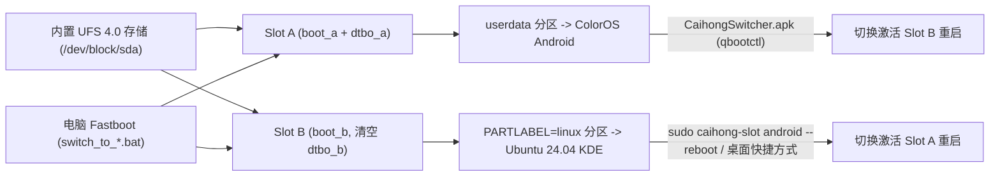

# OnePlus Pad Pro (caihong) Dual Boot

> 一加平板 Pro（型号 `OPD2404` / 代号 `caihong`，高通 SM8650 骁龙 8 Gen 3）的 **ColorOS Android (Slot A) + 主线 Linux 7.3 Ubuntu 24.04 ARM64 KDE Plasma Wayland (Slot B)** 裸机双系统完整工程套件。

这个仓库解决的问题是：**在不破坏原版 ColorOS、不使用虚拟机的前提下，让一加平板 Pro 实现原汁原味的原厂安卓与完整桌面级 Ubuntu 24.04 双系统独立共存**，并针对真实平板硬件与日常使用中的顽固 Bug（手电筒故障/卡死、10-bit/UBWC 与 Xwayland 导致的文字花屏和软件闪屏、磁吸键盘虚拟设备干扰平板模式与拼音输入法切换不稳定）做了系统级内核与用户态适配。

---

## ⚠️ 适用设备与风险提示

- **仅限机型**：OnePlus Pad Pro / 一加平板 Pro（`OPD2404`，SM8650，`caihong`）。**请勿直接刷入其他平板或手机。**
- **前置要求**：已解锁 Bootloader，且 Android 端已获取 Root 权限（Magisk / KernelSU / APatch）。
- **操作风险**：涉及 `parted` 修改 UFS `userdata` 分区与刷写 `boot_b` / `dtbo_b`；虽然方案保留原 Slot A 系统分区，但修改分区表仍有数据丢失风险，**务必在动手前完整备份重要个人数据及原厂分区镜像**。

---

## 一、 双系统是如何工作的？（架构原理）

高通 SM8650 设备天然支持 **A/B 双启动槽位**。本方案利用两个槽位彻底隔离两个操作系统，互不抢占存储和内核：



- **Slot A（Android）**：保持原版 `boot_a`、`dtbo_a`、`super` 与缩容后的 `userdata` 不变，ColorOS 照常启动与使用。
- **Slot B（Ubuntu）**：在 `boot_b` 写入集成了 `sm8650-oneplus-caihong.dtb` 的主线 Linux 7.3 内核，擦除 `dtbo_b` 防止安卓 DTBO 覆盖主线设备树；内核启动参数指定 `root=PARTLABEL=linux`，直接挂载你在磁盘末尾划出的 `linux` 分区运行完整 KDE Plasma Wayland。

---

## 二、 功能适配清单与仓库内含修复

| 模块 | 状态与技术细节 | 对应代码/脚本/补丁 |
| :--- | :--- | :--- |
| **显示与高刷** | 3000×2120 屏幕支持 120Hz/144Hz 切换；强制线性 8-bit `AR24`（关闭 10-bit `AR30`、UBWC 与撕裂）+ WebKit/Electron 原生 Wayland，消除文字花屏与窗口闪烁 | [patch_nt36532_144hz.py](scripts/patch_nt36532_144hz.py)、[build_ubuntu24_kde_clean.sh](scripts/build_ubuntu24_kde_clean.sh) |
| **触控与手写笔** | Novatek NT36532E 触控 + 手写笔支持、自动旋转、电池/供电管理与按键息屏策略 | [build_ubuntu24_kde_clean.sh](scripts/build_ubuntu24_kde_clean.sh) |
| **输入法与虚拟键盘** | 内核仅在真机磁吸键盘接入时才创建键盘/触控板设备；`caihong-im-auto` 监听实体 QWERTY 键盘热插拔，在 **Maliit 中文拼音虚拟键盘（平板模式）** 与 **Fcitx5 Wayland 拼音（键盘模式）** 间自动无感切换 | [oneplus-pogo-dynamic-input.patch](scripts/patches/oneplus-pogo-dynamic-input.patch)、[build_ubuntu24_kde_clean.sh](scripts/build_ubuntu24_kde_clean.sh) |
| **后置手电筒** | 修正 PM8550 4CH Torch 步进电流为 `12.5mA/step`（消除 `0x49` 故障）；脚本优先控制 `yellow:flash-0` sysfs 并配有 Qt6 亮度控制界面 | [leds-qcom-flash-pm8550-torch-ires.patch](scripts/patches/leds-qcom-flash-pm8550-torch-ires.patch)、[caihong-flashlight](scripts/rootfs_overlay/usr/local/sbin/caihong-flashlight)、[main.cpp](scripts/caihong_flashlight_gui/main.cpp) |
| **相机与视频硬解** | 前后摄像头硬件 ISP (`libcamera 0.7.2` + `qcam`)、高通 Iris VA-API 硬件加速与 BPS striping 过滤补丁 | [libcamera-bps-striping-filter.patch](scripts/patches/libcamera-bps-striping-filter.patch)、[deploy/packages/](deploy/packages) |
| **Wi-Fi / 蓝牙 / ADB** | 固定美区/5GHz 主动扫描、`btmgmt` FIFO 封装防 systemd 卡死、NVRAM MAC 读写修复、开机 USB ADB 与 SSH | [patch_hardware_mac_btmgmt.py](scripts/patch_hardware_mac_btmgmt.py) |
| **双系统互切** | Android 端 Jetpack Compose App（内嵌 `libqbootctl.so`）；Ubuntu 端桌面“切换到 Android”图标；Windows `.bat` Fastboot 切槽脚本 | [android_switcher/](android_switcher)、[deploy/](deploy) |

---

## 三、 仓库目录导览

```text
├── README.md                          # 本文档：项目概览、使用教程与排错指南
├── docs/
│   └── BUILD_FROM_SOURCE.md           # 开发者文档：主机环境、内核编译与 RootFS 从零复现完整步骤
├── android_switcher/                  # Android 端切系统 App 源码 (Kotlin Compose + JNI qbootctl)
│   ├── README.md                      # 切换器原理与编译说明
│   ├── build_qbootctl.ps1             # 使用 Android NDK 编译 libqbootctl.so
│   └── app/src/main/cpp/              # UFS BSG / GPT A/B 槽位控制 C 源码
├── deploy/                            # 刷机脚本、分区指引与轻量化辅助工具
│   ├── README.md                      # 部署目录清单、大镜像说明与默认账号信息
│   ├── 00_repartition_guide.md        # 无损缩容 userdata 并划出 linux 分区教程
│   ├── 02_flash_ubuntu_dualboot.bat   # Windows Fastboot 一键刷入 Ubuntu 到 Slot B
│   ├── switch_to_android.bat          # Fastboot 切回 Slot A (Android)
│   ├── switch_to_ubuntu.bat           # Fastboot 切回 Slot B (Ubuntu)
│   ├── CaihongSwitcher.apk            # 预编译好的 Android 切换器安装包
│   ├── vbmeta_disabled_b.img          # Slot B 禁用 AVB 验证镜像
│   ├── tools/qbootctl                 # 预编译 ARM64 通用槽位切换工具
│   └── packages/                      # 预编译 libcamera、Iris VA-API 与 Qt6 手电筒 GUI
└── scripts/                           # 内核、RootFS 构建与校验脚本集合
    ├── clone_and_inspect_kernel.sh    # 拉取上游 Osilvfe/linux (caihong-v7.3) 与 mkbootimg
    ├── download_assets.py             # 下载上游内核启动包、模块包与平台固件包
    ├── download_arch_rootfs.sh        # 下载上游 Arch sparse 分片作为平台资产参考源
    ├── find_ubuntu.py                 # 查询 Ubuntu 24.04 ARM64 Base rootfs 下载地址
    ├── build_kernel_snapd.sh          # 应用仓库补丁、编译内核并输出 deploy/boot/caihong-boot-linux.img
    ├── verify_and_sync_kernel.sh      # 校验新编译 boot 镜像并同步模块至 RootFS 缓存
    ├── build_ubuntu24_kde_clean.sh    # 从零构建纯净 Ubuntu 24.04 KDE Plasma Wayland 镜像
    ├── fast_pack_and_verify.sh        # 增量同步配置并快速重打包验证 RootFS 镜像
    ├── verify_ubuntu_kde_rootfs.sh    # RootFS 完整性、CRLF 与 sparse 元数据块自检
    ├── fix_sparse_zero_metadata.py    # 修正 Android sparse ext4 元数据块（防刷机后挂载损坏）
    ├── check_boot_cfg.py              # 检查 boot 镜像内嵌 IKCFG 内核配置
    ├── check_release.py               # 查询上游 Osilvfe/caihong-linux-rootfs Release 资产
    ├── get_release_urls.py            # 提取上游 Release 下载 URL
    ├── create_vbmeta_disabled.py      # 从 stock_vbmeta_a.img 生成禁用校验的 vbmeta_disabled_b.img
    ├── patch_nt36532_144hz.py         # 内核 NT36532 屏幕 144Hz 补丁脚本
    ├── patch_hardware_mac_btmgmt.py   # 修复 BlueZ 5.72 btmgmt 在 systemd 下阻塞的问题
    ├── caihong_flashlight_gui/        # Qt6 手电筒图形界面源码 (main.cpp)
    ├── rootfs_overlay/                # 覆盖写入 RootFS 的定制工具（如新版 caihong-flashlight）
    └── patches/                       # Git 补丁集合（闪光灯/磁吸键盘/libcamera/手电筒脚本）
```

> 说明：由于 GitHub 单文件限制（100 MB），数 GB 级的系统刷机镜像（`deploy/boot/caihong-boot-linux.img`、`deploy/rootfs/caihong-ubuntu24-rootfs.ext4.sparse.img` 及 `caihong-linux-rootfs/` 克隆）已通过 `.gitignore` 排除，需按第四节说明先行构建或放置到位。

---

## 四、 使用教程（从零上手流程）

### 步骤 1：准备刷机镜像与备份原厂分区

1. 在电脑端确保已安装 Android Platform Tools（`adb` / `fastboot`）与高通/一加 Fastboot 驱动。
2. 备份设备原厂分区（至少保留 `boot_b`、`dtbo_b`、`vbmeta_a`、`vbmeta_b`），具体命令见 [deploy/README.md](deploy/README.md)。
3. 准备好两个核心镜像文件并放到 `deploy/` 对应位置（如需自己编译生成，请先阅读 [docs/BUILD_FROM_SOURCE.md](docs/BUILD_FROM_SOURCE.md) 完成构建）：
   - `deploy/boot/caihong-boot-linux.img`
   - `deploy/rootfs/caihong-ubuntu24-rootfs.ext4.sparse.img`

### 步骤 2：在 UFS 上划出 `linux` 分区

严格按照 [deploy/00_repartition_guide.md](deploy/00_repartition_guide.md) 使用 `parted /dev/block/sda` 将末尾的 `userdata` 缩容（例如划出 64GB），在末尾新建名为 **`linux`** 的 `ext4` 分区。

### 步骤 3：进入 Fastboot 一键刷写并启动 Ubuntu

平板执行 `adb reboot bootloader` 进入 Fastboot 后，在 Windows 上双击（或在终端）运行：

```bat
cd deploy
02_flash_ubuntu_dualboot.bat
```

脚本会自动执行：
1. 擦除 `dtbo_b`
2. 刷入 `deploy/boot/caihong-boot-linux.img` 到 `boot_b`
3. 刷入 `deploy/rootfs/caihong-ubuntu24-rootfs.ext4.sparse.img` 到 `linux` 分区
4. 切换活动槽位到 Slot B 并重启进入 Ubuntu 24.04 KDE

> 首次启动默认账户：`ubuntu` / 密码 `ubuntu`（具备免密 `sudo` 权限），`root` / 密码 `root`，默认主机名 `OnePlus-Pad-Pro`。首次启动阶段系统会自动将 `linux` 分区文件系统扩容至分区完整容量。

### 步骤 4：安装 Android 切换器实现随时互切

切回 Android 后，将切换器安装到 ColorOS 并授予 Root 权限：

```bat
adb install deploy\CaihongSwitcher.apk
```

之后双系统的日常切换闭环如下：
- **在 Android 里切去 Ubuntu**：打开 **CaihongSwitcher** -> 点击切换到 **Slot B** 并重启。
- **在 Ubuntu 里切回 Android**：点击桌面 **“切换到 Android”** 图标，或终端运行 `sudo caihong-slot android --reboot`。
- **救砖/电脑手动切槽**：进入 Fastboot 后直接运行 `deploy/switch_to_android.bat` 或 `deploy/switch_to_ubuntu.bat`。

---

## 五、 常见故障排错（FAQ）

<details>
<summary><b>1. 刷完后卡开机、黑屏或提示启动校验失败如何救回 Android？</b></summary>

长按电源键 + 音量下键强制重启进入 Fastboot 模式，执行：
```bat
fastboot --set-active=a
fastboot reboot
```
或直接运行 `deploy\switch_to_android.bat` 即可安全回到原版 ColorOS。如确定要启动 Slot B 但遇到 AVB 验证报错，可在 Fastboot 中补刷 `deploy\vbmeta_disabled_b.img`：
```bat
fastboot --disable-verity --disable-verification flash vbmeta_b deploy\vbmeta_disabled_b.img
```
</details>

<details>
<summary><b>2. 为什么不能直接用普通 `img2simg` 生成 sparse 镜像刷写 `linux` 分区？</b></summary>

一加/高通 Bootloader 在不预先 `fastboot erase linux` 时直接刷写 Android sparse 镜像，可能会跳过 `CHUNK_TYPE_FILL(0)` 和 `DONT_CARE` 块，导致磁盘残留旧数据时出现 ext4 元数据校验错误并回落 `emergency_ro` 只读挂载。本仓库在打包阶段通过 [fix_sparse_zero_metadata.py](scripts/fix_sparse_zero_metadata.py) 把涉及 superblock / 组描述符 / bitmap / inode table / journal 的元数据全部分片改写为 `CHUNK_RAW`，根除此问题。
</details>

<details>
<summary><b>3. 重启进入 Ubuntu 后手电筒、输入法或画面异常怎么办？</b></summary>

- **手电筒**：本仓库构建流程已内置 PM8550 12.5mA Torch 内核补丁和 sysfs 优先脚本；如手动从上游更新了内核或脚本，请确保重新打包并安装 `scripts/patches/leds-qcom-flash-pm8550-torch-ires.patch` 与 `scripts/rootfs_overlay/usr/local/sbin/caihong-flashlight`。
- **虚拟键盘不弹 / 拼音无法切出**：平板模式下请确认 `systemctl --user status caihong-im-auto.service` 处于 `active (running)`；该服务依赖 [oneplus-pogo-dynamic-input.patch](scripts/patches/oneplus-pogo-dynamic-input.patch) 隐藏未连接状态的虚拟 Pogo 键盘，从而允许 KDE `maliit-keyboard` 接管触控输入并在接入实体键盘后自动切回 `fcitx5`。
- **文字花屏 / 窗口闪烁**：检查 `/etc/environment.d/90-caihong-display.conf` 中 `KWIN_DRM_PREFER_COLOR_DEPTH=24`、`FD_MESA_DEBUG=noubwc`、`WEBKIT_DISABLE_DMABUF_RENDERER=1`、`QT_QPA_PLATFORM=wayland;xcb` 及 `kwinrc` 中 `AllowTearing=false` 是否生效。
</details>

---

## 六、 致谢与上游项目

- 主线内核与平台硬件适配基线：[Osilvfe/caihong-linux-rootfs](https://github.com/Osilvfe/caihong-linux-rootfs) 与 `Osilvfe/linux` (`caihong-v7.3`)
- UFS 槽位控制实现参考：`qbootctl`
